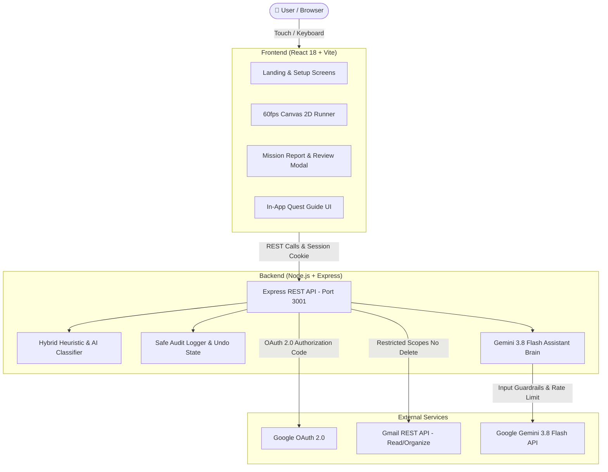

<div align="center">

# 🛸 Inbox Quest
### *Turn inbox cleanup into a fast-paced courier runner mission.*

[](LICENSE)
[](https://react.dev/)
[](https://vitejs.dev/)
[](https://nodejs.org/)
[](https://deepmind.google/technologies/gemini/)
[](backend/assistant/brain.test.js)

**Conceived, Designed & Architected by [Arjun Singh](https://github.com/wdymarjun)**

[Live Demo](https://indexquest.vercel.app/) • [API Contract](docs/API_CONTRACT.md) • [Report Bug](https://github.com/wdymarjun/inbox-quest/issues)

</div>

---

## 📖 Executive Overview

Traditional inbox cleanup fails not from lack of tools, but from **cognitive decision fatigue**. Staring at hundreds of unread emails triggers dread, avoidance, and administrative paralysis.

**Inbox Quest** rethinks triage from first principles:
- **Gamified Micro-Batching:** Instead of facing thousands of messages, users tackle bite-sized missions of **10, 25, or 50 emails**.
- **Interactive Courier Runner:** Every email becomes a physical obstacle on a retro 2D runway. Jumping over low promotional clutter or crouching beneath overhead newsletters triggers safe triage classifications in real time.
- **Zero-Deletion Guarantee:** Email deletion is **strictly prohibited by code**. Uncertain messages are preserved for human review, and all actions are **100% reversible in one tap**.
- **Dedicated Quest Brain:** Built-in AI help assistant powered by **Gemini 3.8 Flash** (`@google/genai`), strictly bounded to assist with game mechanics, triage safety, and platform guidance without hallucination.

---

## 🏛 System Architecture



---

## 🛡 Security & Safety Guarantees

Inbox Quest is engineered with strict defensive boundaries:

| Security Pillar | Technical Implementation |
|---|---|
| **Zero Deletions Guarantee** | The backend mutation router strictly rejects and forbids any `delete` action code-wide. |
| **Least-Privilege Scopes** | Google OAuth requests read and organize scopes only (`gmail.modify` restricted to archive/label). No deletion permissions are requested or held. |
| **Human-in-the-Loop Confirmation** | OAuth authentication is **never** treated as blanket permission to mutate email. When using live Gmail, proposed actions are presented in an explicit review modal before any changes occur. |
| **1-Click Audit Rollback** | Every triage operation is logged in an in-memory session ledger. Users can undo an entire mission's actions in a single tap from the Results screen. |
| **Token Isolation** | OAuth tokens and client secrets are never exposed to the frontend, browser local storage, or React URLs. Session status is validated via secure HTTP endpoints. |
| **Safe Sandbox Mode** | Fully functional out of the box with 50 realistic simulated mock emails (security alerts, receipts, promotions, ambiguous drafts) without requiring any Google account connection. |

---

## 🎮 The Courier Runner Experience

- **60fps Canvas Physics Engine:** Custom lightweight 2D physics running on HTML5 Canvas with sub-pixel rendering and GPU compositor acceleration (`transform: translateZ(0)`).
- **Tactile Zero-Latency Controls:**
  - **Jump:** `Space`, `↑ Arrow`, or tap the screen / on-screen Jump button.
  - **Crouch:** Hold `↓ Arrow`, `S`, or hold the on-screen Duck button.
  - Zero-latency `onPointerDown` gesture capture eliminates the 300ms mobile touch delay.
- **Dynamic Email Hazards:**
  - Low obstacles: Promotional mail & discount flyers (jump to clear and archive).
  - Overhead barriers: Longform newsletters & digests (duck to label *Read Later*).
  - High-priority beacons: Security alerts, financial bills, and authentic work correspondence (safely flagged and preserved in inbox).
- **Particle Throttling:** Capped particle bursts ensure silky-smooth 60fps performance on low-end mobile devices and high-refresh desktop monitors alike.

---

## 🧠 Dedicated Gemini 3.8 Flash Assistant

Mounted at `POST /api/assistant/chat`, the assistant is a **specialized in-product Quest Guide** built with Google's `@google/genai` SDK:

- **Strictly Grounded:** Answers questions strictly about Inbox Quest mechanics, game controls, safety guarantees, and OAuth workflow.
- **Out-of-Scope Refusal:** Gracefully declines general queries, coding questions, creative writing, or external browsing with a polite single-sentence refusal.
- **Defensive Safeguards:**
  - Hard input ceiling: 1,000 characters maximum per question.
  - Body payload limit: 12 KB maximum (`express.json({ limit: '12kb' })`).
  - IP-based rate limiting (10 requests per minute burst control).
  - Zero access to user email data, tokens, or live mutation handlers.
- **Test Suite:** 11 comprehensive automated tests covering prompt injection defense, rate limits, error responses, and payload bounds (`npm test` in `backend/`).

---

## 📁 Repository Structure

```
inbox-quest/
├── frontend/                     # React 18 + Vite Client
│   ├── src/
│   │   ├── components/           # Modular UI widgets
│   │   │   ├── GmailActionReviewModal.jsx  # Confirmation gate before mutation
│   │   │   ├── GoogleSignInButton.jsx      # Official Google branding button
│   │   │   ├── InboxQuestAssistant.jsx     # Floating Gemini chat guide
│   │   │   └── StatusBadge.jsx             # Connection & session indicator
│   │   ├── screens/              # Core app screens
│   │   │   ├── LandingScreen.jsx           # Monolith hero & how-it-works
│   │   │   ├── SetupScreen.jsx             # Source selector & batch picker
│   │   │   ├── InboxScreen.jsx             # Read-only batch inspection view
│   │   │   ├── GameScreen.jsx              # 60fps courier runner canvas
│   │   │   └── ResultsScreen.jsx           # Mission report, stats & 1-click undo
│   │   ├── api.js                # API integration & fallback state
│   │   ├── auth.js               # OAuth status subscription
│   │   └── index.css             # High-contrast dark monochrome design system
│   ├── vercel.json               # SPA routing & deployment rules
│   └── package.json
│
├── backend/                      # Node.js + Express API
│   ├── assistant/                # Dedicated Gemini Brain
│   │   ├── brain.js              # System instructions, input validation & SDK call
│   │   └── brain.test.js         # 11/11 automated test suite
│   ├── classifier.js             # Hybrid rule-based & AI email classification
│   ├── actionLog.js              # Reversible audit log & undo engine
│   ├── server.js                 # Express app, security middleware & routes
│   └── package.json
│
├── docs/
│   └── API_CONTRACT.md           # Formal JSON endpoint specification
├── vercel.json                   # Root deployment configuration
└── README.md
```

---

## 🚀 Getting Started

### Prerequisites
- **Node.js** v18.0.0 or higher
- **npm** or **pnpm**

### 1. Clone Repository
```bash
git clone https://github.com/wdymarjun/inbox-quest.git
cd inbox-quest
```

### 2. Backend Setup
```bash
cd backend
npm install

# (Optional) Configure Gemini API & Google OAuth
cp .env.example .env
```

Edit `backend/.env` (optional for local demo sandbox):
```ini
PORT=3001
GEMINI_API_KEY=your_gemini_api_key_here
GEMINI_MODEL=gemini-3.8-flash

# Optional: Google OAuth Credentials (for live Gmail testing)
GOOGLE_CLIENT_ID=your_client_id.apps.googleusercontent.com
GOOGLE_CLIENT_SECRET=your_client_secret
GOOGLE_REDIRECT_URI=http://localhost:3001/api/auth/google/callback
SESSION_SECRET=your_random_session_secret
```

Start the backend server:
```bash
npm start
# Server running on http://localhost:3001
```

Run backend unit tests:
```bash
npm test
# 11/11 tests passing (Input limits, prompt injection, rate limiting, route tests)
```

### 3. Frontend Setup
In a new terminal:
```bash
cd frontend
npm install
npm run dev
# Vite dev server running on http://localhost:5173
```

Open [http://localhost:5173](http://localhost:5173) in your browser.

---

## 🌐 1-Click Vercel Deployment

Inbox Quest is pre-configured for instant deployment on Vercel:

[](https://vercel.com/new/clone?repository-url=https://github.com/wdymarjun/inbox-quest&root-directory=frontend)

1. Click the button above.
2. Select your repository.
3. Keep default settings (`frontend` as root directory, Vite preset).
4. Click **Deploy**. Your app is live in under 45 seconds!

---

## 📡 API Contract Summary

| Method | Endpoint | Description |
|---|---|---|
| `GET` | `/api/inbox/fetch?batchSize=25&source=demo` | Fetches email batch (Demo or Live Gmail) |
| `POST` | `/api/inbox/classify` | Returns category, confidence & suggested actions |
| `POST` | `/api/actions/apply` | Applies confirmed actions (archive / label / flag) |
| `POST` | `/api/actions/undo` | 1-Click reversal of previously applied actions |
| `GET` | `/api/actions/log` | Retrieves audit log of current session actions |
| `POST` | `/api/assistant/chat` | Gemini 3.8 Flash help guide (rate-limited, 12KB cap) |
| `GET` | `/api/auth/status` | Reports OAuth configuration and connection state |
| `POST` | `/api/auth/disconnect` | Revokes current session and signs out safely |

For exhaustive schema definitions and error formats, see [docs/API_CONTRACT.md](docs/API_CONTRACT.md).

---

## 🎨 Design Philosophy & Accessibility

- **Monochrome Dark Aesthetic:** Elegant `#080808` obsidian theme with silver specular edge accents and high contrast text ratios ($> 7:1$).
- **Responsive Viewports:** Tested and polished across 320px, 375px, 390px, 768px, and 4K desktop displays.
- **Accessibility (`a11y`):**
  - All interactive buttons meet Apple/Google minimum $48\text{px} \times 48\text{px}$ touch target sizes.
  - Full keyboard navigation support (Space / Arrows).
  - ARIA attributes and live regions for dynamic score and triage toasts.
  - Strict compliance with `prefers-reduced-motion: reduce`.

---

## 📄 License & Attribution

Distributed under the **MIT License**. See `LICENSE` for details.

Crafted with care by **[Arjun Singh](https://github.com/wdymarjun)**.
